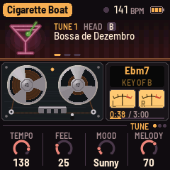

# BOSSA LOUNGE

Endless bossa nova for the M-VAVE FM-1. Small combo, plays by itself from power-on.

## What it plays

Generated tunes, one after another, each with its own title, key and form (AABA or ABAC). Nylon guitar comps in
bossa figures with jazz voicings. Brushes with a rim click on the clave. Upright bass on root and fifth. Flute or
vibraphone carries the melody. Every tune runs head, solo chorus, head out, soft tag ending, then a short pause and
the next one. Some last choruses lift a half step.

Screen: a hi-fi in a dim bar. Reel-to-reel turning, packs growing and shrinking through the tune, rewinding between
tunes. Two VU meters, the current chord and key, a neon martini glass that flickers on accents.

## Controls

| Control | Does |
| --- | --- |
| Knobs 1-4 | page's values. Tune page: tempo, feel (straight to laid back), mood (sunny to saudade), melody |
| HOME, ENV, GLO | pages: Tune, Combo (guitar, bass, drums, lead), Room (tone, reverb, tune length, lights) |
| SELECT | steps pages |
| ALGORITHM | tone |
| PRESETS | style. Each keeps its own settings |
| PLAY | tape rolls / stops |
| EDIT | next tune |
| REC | repeat: this tune plays on |
| OCT- / OCT+ | keys' octave |
| Keys | play the vibraphone along |
| SAVE | saves. Held: style back to its recipe |

Hold any button for its help card. Settings also save themselves at a quiet moment. USB audio follows MASTER.

## Styles

Cigarette Boat, Umbrella Stand, Bellhop's Break, Slow Caipirinha, Four Mallets, Melted Ice, Seersucker, Olive Number
Two, Chlorine Blue, Unmailed Letters, Red Banquette, Striped Awning, Two Chairs Left, Paper Parasol. Fast samba to
slow ballads; flute, vibes or both; one is guitar and flute alone.

## Credits

Built on [AMB-1](https://github.com/charlesvestal/fm1-amb) by Charles Vestal (its platform use, knob strip, help
cards, screen reader), on [fm1-base](https://github.com/charlesvestal/fm1-base) and
[felucca-bsp](https://github.com/hugelton/felucca-bsp), from Felucca by Leo Kuroshita (Hügelton Instruments).
MPL-2.0: see `LICENSING.md`.
