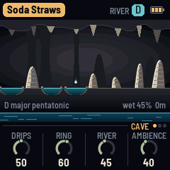

# CAVE

Water dripping in a cavern, played as music on the M-VAVE FM-1. Plays by itself from power-on.

## What it plays

Drips fall from the ceiling, each point at its own steady rate, so their notes phase against each other. Each lands
on a stalagmite (tuned stone) or a pool (tuned water). Every cave has its own tuning set: pentatonics, just
intonation, slendro, a harmonic series, whole tone. No semitones in any set, so nothing rubs.

Wetness wanders over hours and sets how many points drip. Stalagmites grow; as one grows its note falls to the next
note down the set. Underground river is the drone, moving slowly through a few chosen harmonies. Now and then a
trickle runs down the flowstone, bats pass, a stone falls and snaps a tip off, or a flood swells the river and
rearranges the pools.

Screen: the cavern in cross-section. Drops falling, stalagmites glowing as they ring, ripples, the river.

## Controls

| Control | Does |
| --- | --- |
| Knobs 1-4 | page's values. Cave page: drips, ring, river, ambience |
| HOME, ENV, GLO | pages: Cave, Space (cavern, echo, tone, width), Setup (growth, events, pebbles, lights) |
| SELECT | steps pages |
| ALGORITHM | ambience (water bed, apart from the music) |
| PRESETS | cave. Each keeps its own settings and its own world |
| PLAY | play / rest |
| EDIT | river moves on to its next harmony |
| Keys | drop a pebble into a pool, snapped to the cave's set |
| OCT- / OCT+ | keys' octave |
| SAVE | saves. Held: cave's knobs back to its recipe |

Hold any button for its help card. Settings save themselves at a lull; each cave's world at most hourly. USB audio
follows MASTER.

## Caves

Soda Straws, Rimstone Pools, Bacon Rind, Fat Man's Misery, Sump Two, Pearl Nest, Lamp Off, Stal Boss, Guano Choir,
Karst Window, Helictite, Ox Bow Lake.

## Credits

Built on [AMB-1](https://github.com/charlesvestal/fm1-amb) by Charles Vestal (its platform use, knob strip, help
cards, screen reader), on [fm1-base](https://github.com/charlesvestal/fm1-base) and
[felucca-bsp](https://github.com/hugelton/felucca-bsp), from Felucca by Leo Kuroshita (Hügelton Instruments).
MPL-2.0: see `LICENSING.md`.
