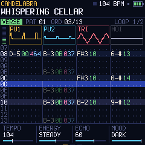

# CHIP TRACKER

Endless 8-bit game music for the M-VAVE FM-1, written live in a tracker. Plays by itself from power-on.

## What it plays

Generated songs, one after another. Each has its own key, mode, tempo and title. Four channels, as on old consoles:
two pulse waves (12.5, 25, 50 % duty), a stepped triangle bass, noise drums. Hummable lead built from short motifs,
second pulse echoing, arpeggiating or harmonising. Intro, verse, chorus, bridge. After a few loops the song ends on
a jingle and the next one starts.

Screen is the tracker: four pattern columns scrolling under a cursor bar (note, instrument, effect), four live
oscilloscopes, song title, section and pattern.

## Controls

| Control | Does |
| --- | --- |
| Knobs 1-4 | page's values. Play page: tempo, energy, echo, mood (happy to dark) |
| HOME, ENV, GLO | pages: Play, Mix (pulse 1, pulse 2, triangle, noise), Song (swing, tone, loops, lights) |
| SELECT | steps pages |
| ALGORITHM | tone |
| PRESETS | style. Each keeps its own settings |
| PLAY | play / stop |
| EDIT | next song |
| REC | repeat: song loops on |
| OCT- / OCT+ | keys' octave |
| Keys | play along on a pulse |
| SAVE | saves. Held: style back to its recipe |

Mood change closes the song on its jingle; next one comes in the new mood. Hold any button for its help card.
Settings save themselves at a quiet moment. USB audio follows MASTER.

## Styles

Extra Life, Lantern Oil, Press Start, Second Form, Innkeeper's Cat, Air Bubble Timer, Cobalt Airlock, Haggle Mode,
Photo Finish, Candelabra, Staff Roll, Save And Quit, Propeller Keep.

## Credits

Built on [AMB-1](https://github.com/charlesvestal/fm1-amb) by Charles Vestal (its platform use, knob strip, help
cards, screen reader), on [fm1-base](https://github.com/charlesvestal/fm1-base) and
[felucca-bsp](https://github.com/hugelton/felucca-bsp), from Felucca by Leo Kuroshita (Hügelton Instruments).
Pixel font from Terminus. MPL-2.0: see `LICENSING.md`.
