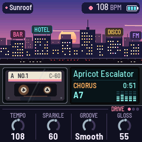

# CITY POP

Endless 1980s Japanese city pop for the M-VAVE FM-1. Plays by itself from power-on.

## What it plays

Generated songs, one after another. Each gets its own key, tempo (95-120 BPM), groove and title. Lush maj7, m9 and
7sus4 chords, royal road and ii-V turns, slash chords. Full form: intro, verse, pre-chorus, chorus, second verse and
chorus, bridge or solo, key change up for the last chorus, fade.

Fingered or slap bass locked to the kick. Rhodes or DX electric piano. Clean chorused guitar cutting sixteenths.
Brass stabs, strings in the choruses. Sung melody on glossy synth lead or soprano sax. Gated drums, tom fills.

Screen shows city at dusk over car stereo. Reels turn, sky drifts with the song, windows and rooftop signs light up
as the chorus arrives. Display shows title, section, chord and band meters.

## Controls

| Control | Does |
| --- | --- |
| Knobs 1-4 | page's values |
| HOME | Drive: tempo, sparkle, groove, gloss |
| ENV | Band: keys, guitar, bass, drums |
| GLO | Front: lead, brass, strings, lights |
| SELECT | steps pages |
| ALGORITHM | sparkle |
| PRESETS | style. Each keeps its own settings |
| PLAY | play / pause |
| EDIT | next song |
| REC | repeat: last chorus goes round |
| OCT- / OCT+ | keys' octave |
| Keys | play electric piano along |
| SAVE | saves. Held: style back to its recipe |

Hold any button for its help card. Settings also save themselves at a quiet moment. USB audio follows MASTER.

## Styles

Sunroof, E.Piano 1, Thumb and Pop, Curly Cord, Bubble Economy, Chorus Pedal, Highball, Pocket Bell, Melon Soda,
Tinted Windows, Rental Yacht, Mirrorball Debt, Escalator Kiss.

## Credits

Built on [AMB-1](https://github.com/charlesvestal/fm1-amb) by Charles Vestal (platform use, knob strip, help cards,
screen reader), on [fm1-base](https://github.com/charlesvestal/fm1-base) and
[felucca-bsp](https://github.com/hugelton/felucca-bsp), from Felucca by Leo Kuroshita (Hügelton Instruments).
MPL-2.0: see `LICENSING.md`.
