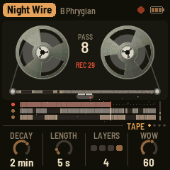

# DECAY LOOPS

Tape looper for the M-VAVE FM-1 whose loops fall apart as they play. After William Basinski's Disintegration Loops.

Writes a phrase (a few chords, a figure or a slow melody), records it onto tape and plays it over and over. Each pass
the tape wears: highs roll off, dropouts open and grow, pitch wobbles, hiss rises, until only fragments are left.
Before a loop is gone, a fresh phrase records on another layer and fades in. Plays from power-on, without end.

Screen shows two reels turning, the tape scrolling past the head with its gaps and fading oxide, and every loop's
wear underneath.

## Controls

- **Keys**: play notes; they go onto the next loop. **OCT− / OCT+**: their octave.
- **PLAY**: tape runs or stops. **REC**: new loop now. **EDIT**: hold (wear stops).
- **PRESETS**: tape stock and mood. **ALGORITHM**: mode. **SELECT**: pages.
- **HOME** Tape: Decay (loop life, 15 min to 39 s), Length (4–12 s), Layers, Wow.
- **ENV** Tone: Stock, Tone, Hiss, Space. **ARP** Phrase: Voice, Phrase, Density, Octave.
- **GLO** Setup: Root, Mode, Tune, Lights.
- **SAVE**: saves. Held: preset back to its recipe. Settings also save by themselves at a quiet moment.
- Hold any button for its help card. Screen reader supported.
- USB audio follows the MASTER knob.

## Presets

Cassette, Reel to Reel, Wax, Wire, Fog, Choir, Brass Memory, Music Box, Hymn, Dust, Snowfield, Lantern, Low Sun,
Night Wire. Each keeps its own settings.

## Tape

27 s of tape, 8-bit mu-law at 11 kHz, shared by all layers: up to two 12 s loops or four 6 s loops at once.

## Build

See [BUILDING.md](BUILDING.md). Install at your own risk.

## Credits

Built on [AMB-1](https://github.com/charlesvestal/fm1-amb) by Charles Vestal (app shell, harmony, plate reverb) and
[fm1-base](https://github.com/charlesvestal/fm1-base) / felucca-bsp, from Felucca by Leo Kuroshita (Hügelton
Instruments). MPL-2.0: see [LICENSING.md](LICENSING.md).
