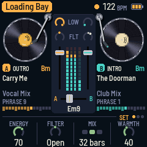

# DEEP HOUSE DECKS

Endless deep house DJ set for the M-VAVE FM-1. Plays by itself from power-on.

## What it plays

Generated records, 118-124 BPM. Four-on-the-floor kick, offbeat open hats, shuffled 16ths, claps on 2 and 4,
shaker, conga and rim. Minor 9th and 11th vamps on Rhodes, organ or pad stabs. Rolling bass locked to the kick.
Now and then a lead hook or a chopped vocal stab.

Records run in 16-bar phrases: drum intro, groove, full, breakdown with the kick out, filter build, drop. A virtual
DJ blends each into the next on a phrase line: new fader up, bass swapped on the low EQ, filter sweeps, crossfader
across. Tempo holds; the next key is always a neighbour.

Screen shows two turntables and a mixer. Platters spin, faders, EQ and filter knobs and meters move with the mix.
Each deck shows its record's title, mix, section and phrase.

## Controls

| Control | Does |
| --- | --- |
| Knobs 1-4 | page's values. Set page: energy, filter, mix length, warmth |
| HOME, ENV, GLO | pages: Set, Groove (tempo, swing, mood, space), Levels (chords, drums, bass, lead) |
| SELECT | steps pages |
| ALGORITHM | master filter |
| PRESETS | set. Each keeps its own settings; the DJ mixes into it |
| PLAY | decks run / stop |
| EDIT | next mix, from the next four-bar line |
| REC | hold: this record plays on |
| OCT- / OCT+ | keys' octave |
| Keys | play along on the set's keys |
| SAVE | saves. Held: set back to its recipe |

Hold any button for its help card. Settings also save themselves at a quiet moment. USB audio follows MASTER.

## Sets

Loading Bay, Fresh Linen, Cicero Ave, Paradise Ticket, Sangria, Velvet Rope, Ghost Stabs, Hammond Sweat, Last
Elevator, Assembly Line, Sticky Floor, Sunday Best, Pool Lights.

## Credits

Built on [AMB-1](https://github.com/charlesvestal/fm1-amb) by Charles Vestal (its platform use, knob strip, help
cards, screen reader), on [fm1-base](https://github.com/charlesvestal/fm1-base) and
[felucca-bsp](https://github.com/hugelton/felucca-bsp), from Felucca by Leo Kuroshita (Hügelton Instruments).
MPL-2.0: see `LICENSING.md`.
