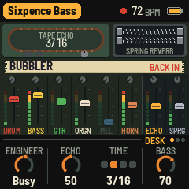

# DUB DESK

Endless roots dub for the M-VAVE FM-1. Reggae band plus engineer who never leaves the desk. Plays by itself from
power-on.

## What it plays

Sixteen original riddims at 65-80 BPM, half-time feel. One-drop, rockers or steppers drums with rim clicks and
rolls. Deep sub bass carries the tune. Guitar skank on the off-beats, organ bubble, now and then a melodica line or
a horn stab. One or two minor chords, or a plain I-IV-V.

Engineer mixes it live, on bar lines. Drops to drum and bass, throws the snare and skank into tape echo, swells the
feedback, kicks the spring tank, sweeps a high-pass, sounds the siren. Then brings the band back. Every few minutes,
next riddim.

Screen is the desk. Faders move by themselves, echo blips ride a tape loop and ripple out, spring tank shakes, riddim
name on masking tape.

## Controls

| Control | Does |
| --- | --- |
| Knobs 1-4 | page's values. Desk page: engineer, echo, echo time, bass |
| HOME, ENV, GLO | pages: Desk, Band (drums, skank, organ, lead), Room (spring, tone, tempo, length) |
| SELECT | steps pages |
| ALGORITHM | tone |
| PRESETS | style. Each keeps its own settings |
| PLAY | tape rolls / stops |
| EDIT | next riddim |
| REC | repeat: this riddim plays on |
| FX | echo throw |
| LFO | kick the spring tank |
| OCT- / OCT+ | keys' octave |
| Keys | play organ along |
| SAVE | saves. Held: style back to its recipe |

Hold any button for its help card. Settings also save themselves at a quiet moment. USB audio follows MASTER.

## Styles

Sixpence Bass, Jukebox Lion, Four Boots Down, Sufferah Smile, Blue Mouthpiece, Kerosene Lamp, Burnt Altar, Bass Bin
Prayer, Ricochet Room, Generator Lawn, Biscuit Tin Mic, Acetate Only, Church Shoes.

## Credits

Built on [AMB-1](https://github.com/charlesvestal/fm1-amb) by Charles Vestal (its platform use, knob strip, help
cards, screen reader), on [fm1-base](https://github.com/charlesvestal/fm1-base) and
[felucca-bsp](https://github.com/hugelton/felucca-bsp), from Felucca by Leo Kuroshita (Hügelton Instruments).
MPL-2.0: see `LICENSING.md`.
