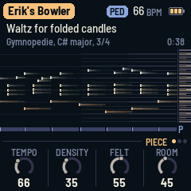

# FELT PIANO

Endless generated solo piano for the M-VAVE FM-1. Plays by itself from power-on.

## What it plays

Pieces, one after another, each with its own key, mode, tempo and title. Five idioms, set by preset: Gymnopedie-like
waltz, Airport-style drifting loops, felt ostinato, nocturne, sparse modal playing. Rubato, swells, a slow ending on
a long note, then quiet and the next.

Modelled piano: soft felt hammers, beating partials, dampers, sustain pedal, sympathetic strings, key noise, small
room.

Screen: scrolling piano roll, each note a line of light fading as it rings. Pedal lane below, title and key on top.

## Controls

| Control | Does |
| --- | --- |
| Knobs 1-4 | page's values. Piece page: tempo, density, felt, room |
| HOME, ENV, GLO | pages: Piece, Touch (rubato, dynamics, pedal, noise), Setup (age, width, piece length, lights) |
| SELECT | steps pages |
| ALGORITHM | felt |
| PRESETS | style. Each keeps its own settings |
| PLAY | play / rest |
| EDIT | next piece |
| REC | repeat: this piece plays on |
| OCT- / OCT+ | keys' octave |
| Keys | play along |
| SAVE | saves. Held: style back to its recipe |

Hold any button for its help card. Settings also save themselves at a quiet moment. USB audio follows MASTER.

## Styles

Erik's Bowler, Slow Carousel, Velvet Lid, Paper Lanterns, Hammer Rail, Una Corda, Lemon Peel, Upright in 4B, Milk
Teeth, Row Q, Seat 9, Blue Pencil, Cold Radiator, Iron Pier, Coat Check.

## Credits

Built on [AMB-1](https://github.com/charlesvestal/fm1-amb) by Charles Vestal (its platform use, knob strip, help
cards, screen reader), on [fm1-base](https://github.com/charlesvestal/fm1-base) and
[felucca-bsp](https://github.com/hugelton/felucca-bsp), from Felucca by Leo Kuroshita (Hügelton Instruments).
MPL-2.0: see `LICENSING.md`.
