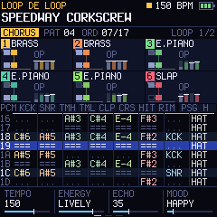

# FM CHIP

Endless 16-bit console game music for the M-VAVE FM-1, in the Mega Drive / Genesis FM style. Plays by itself from power-on.

## What it plays

Generated songs, one after another. Each is a level from a game that never shipped: stage, boss, menu, credits. Six
four-operator FM channels with the classic algorithms and feedback, plus PCM drums and a noise hat. Brass and synth
leads, slap bass, bells, electric pianos, stabs with the push before the bar. Intro, verse, chorus, bridge. Some
games lift the last chorus a key up. Then a jingle, then the next song.

Screen is the register view: each channel's patch, algorithm and live operator envelopes, drum pads, and the
pattern list scrolling under a cursor bar.

## Controls

| Control | Does |
| --- | --- |
| Knobs 1-4 | page's values. Play page: tempo, energy, echo, mood (happy to dark) |
| HOME, ENV, GLO | pages: Play, Mix (lead, chords, bass, drums), Song (swing, tone, loops, lights) |
| SELECT | steps pages |
| ALGORITHM | tone |
| PRESETS | game. Each keeps its own settings |
| PLAY | play / stop |
| EDIT | next song |
| REC | repeat: song loops on |
| OCT- / OCT+ | keys' octave |
| Keys | play along on the game's lead patch |
| SAVE | saves. Held: game back to its recipe |

Mood change closes the song on its jingle; next one comes in the new mood. Hold any button for its help card.
Settings save themselves at a quiet moment. USB audio follows MASTER.

## Games

Loop De Loop, Weak Point Glow, Pit Lane Duel, Option Pods, Sound Test 07, Good Ending, Penguin Physics, Pipe Wrench,
Inn Is 10 Gold, Spike Ceiling, Bonus Car Smash, Blast Processing, Last Continue.

## Credits

Built on [AMB-1](https://github.com/charlesvestal/fm1-amb) by Charles Vestal (its platform use, knob strip, help
cards, screen reader), on [fm1-base](https://github.com/charlesvestal/fm1-base) and
[felucca-bsp](https://github.com/hugelton/felucca-bsp), from Felucca by Leo Kuroshita (Hügelton Instruments).
Pixel font from Terminus. MPL-2.0: see `LICENSING.md`.
