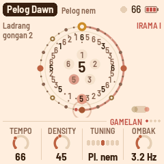
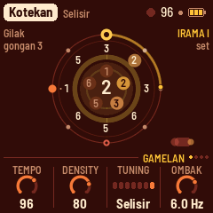
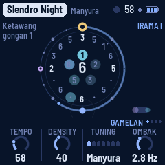

# GAMELAN

Endless generated gamelan for the M-VAVE FM-1. Javanese and Balinese-inspired. Plays by itself from power-on.

  

## What it plays

Gong cycles (lancaran, ketawang, ladrang, gilak) marked by gong, kempul, kenong and ketuk. Balungan on saron and
slenthem. Peking, bonang and interlocking kotekan around it. Kendang leads tempo changes (irama). Some presets add
suling. Slendro and pelog in cents, paired instruments beating (ombak), warm modal metal. New pieces endlessly,
each ending slowing to the gong.

Screen draws the cycle as a mandala: gong at the top, strokes bloom, balungan in its numbers, lotus of the five
tones at the heart.

## Controls

| Control | Does |
| --- | --- |
| Knobs 1-4 | page's values. Gamelan page: tempo, density, tuning, ombak |
| HOME, ENV, ARP, GLO | pages: Gamelan, Mix, Colour (kendang, suling, reverb, mallet), Setup (pitch, irama, form, lights) |
| SELECT | steps pages. HOME + SELECT: tempo |
| ALGORITHM | tuning |
| PRESETS | preset. Each keeps its own settings |
| PLAY | play / rest |
| EDIT | new piece: this one ends at the next kenong or gong |
| REC | hold: stay in this piece |
| OCT- / OCT+ | slower / faster irama |
| Keys | white: a bar in the tuning. Black: gong, kempul, kenong, ketuk, kempyang, kendang |
| SAVE | saves. Held: preset back to its recipe |

Hold any button for its help card. Settings also save themselves at a quiet moment. USB audio follows MASTER.

## Presets

Pelog Dawn, Slendro Night, Temple, Rain Court, Kotekan, Gong Ageng, Water Palace, Moon Pavilion, Rice Terraces,
Shadow Play, Bronze Garden, Monsoon, Incense, Palm Shade.

## Credits

Built on [AMB-1](https://github.com/charlesvestal/fm1-amb) by Charles Vestal (its platform use, knob strip, help
cards, screen reader and plate reverb), on [fm1-base](https://github.com/charlesvestal/fm1-base) and
[felucca-bsp](https://github.com/hugelton/felucca-bsp), from Felucca by Leo Kuroshita (Hügelton Instruments).
An homage to gamelan traditions, not a reproduction of any repertoire. MPL-2.0: see `LICENSING.md`. Building:
`BUILDING.md`.
