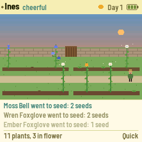

# GARDEN for the M-VAVE FM-1

Melody garden that plays itself. Press a key, plant a seed at that pitch. Over minutes it sprouts, grows a phrase,
flowers with bells, goes to seed, withers and leaves compost that hums. Gardener tends it. Bees, a rabbit, rain and
frost make the drama. Everything is kept across power-offs.

## Life of a plant

- **Seed**: in the ground. Yours rings once so you know.
- **Sprout**: one soft note now and then.
- **Growing**: short loop in the garden's scale, built from its pitch. A note more as it grows.
- **In flower**: whole phrase, with bells an octave up.
- **Seeding**: scatters one or two seeds on nearby plots. Related notes, one note changed.
- **Withering**: first notes only, slower, softer.
- **Compost**: low drone that fades. Gardener digs it in.

Every plant has a name (Lantern Rose, Moss Bell) and parents. Ledger page lists them.

## The world

- **Gardener**: named, with a mood. Waters the driest plant, prunes long phrases when crowded, picks a favourite and
  plants copies when the garden thins, turns old compost.
- **Bees**: cross two flowers into a hybrid. Half of each phrase.
- **Rabbit**: nibbles sprouts. Twice and it's gone. Gardener shoos it if close.
- **Weather**: sun, cloud, rain (everything grows fast, rain patters on the hats), frost (sprouts and weak plants
  wither).
- **Day and night**: a day is 15 minutes of growing. Night is darker and softer.
- Empty garden seeds itself over the wall. Never silent.

Fuller garden: brighter, denser bells, quieter pad. Sparse garden: more pad and reverb, slower chords.

## Presets

LFO steps through thirteen sound palettes, SEL steps back: Cottage (as 1.0), Zen, Moonlight, Greenhouse, Wildflower,
Herb, Rain Garden, Orchard Wall, Winter Bed, Kitchen Garden, Rose Arbour, Fern Hollow, Sundial. Name shows on screen.
Each recolours the garden: key, mode, tempo, space, and AMB-1 Drift 1.1's strings, lead, air and shimmer. Plants,
phrases, gardener and ledger stay as they are. Kept with the settings. Pad colour stays yours (Sound page: Colour, now
with Strings). Details: `docs/presets.md`.

## Controls

| | |
|---|---|
| Keys | Plant a seed (low keys left, high keys right) |
| PLAY · REC | Grow / rest · freeze (time stops) |
| EDIT · ARP | Gardener waters everything · seed at a random note |
| HOME · ENV · GLO · SEQ | Pages: Garden, Sound, Setup, Ledger. SELECT steps through |
| KNOB 1–4 | Garden: Tempo, Growth, Bells, Pad. Sound: Bass, Echo, Reverb, Colour. Setup: Root, Tune, MIDI out, Lights |
| ALGORITHM | Mode (the scale) |
| LFO · SEL | Next · last preset |
| PRESETS | Scroll the ledger |
| OCT− / OCT+ | Bells' octave |
| SAVE | Save. Hold 3 s: new garden |

Saves by itself, rarely (flash wear): the garden about once an hour, settings within 5 minutes, and once when the
battery reads empty. A power-off can lose up to an hour of the garden; SAVE keeps it now.
USB audio as AMB-1: no level setting of its own.

## Build

See `CLAUDE.md`. `./build.sh --release 1.1` in WSL makes `app/build/garden-1.1.fwsc`.

## Credits

Engine (pad, FM bells, bass, echo, tape loop, plate reverb), UI helpers and build: [AMB-1](https://github.com/charlesvestal/fm1-amb)
by Charles Vestal. Strings, lead, air and shimmer from AMB-1 Drift 1.1. Platform: [fm1-base](https://github.com/charlesvestal/fm1-base) and
[felucca-bsp](https://github.com/hugelton/felucca-bsp), from Felucca by Leo Kuroshita (Hügelton Instruments).
MPL-2.0. See `LICENSING.md`.
