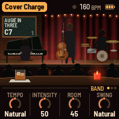

# JAZZ TRIO

Endless jazz piano trio for the M-VAVE FM-1. Plays by itself from power-on.

## What it plays

Piano, upright bass and drums working through a set in a small club. Every tune is new: swing, ballads, blues,
rhythm changes, modal tunes, jazz waltzes, each with its own key, tempo, form and title.

Count-in or intro, head, piano solos that build chorus by chorus, sometimes a bass solo or fours traded with drums,
head out, then a tag, ritardando or Basie ending. Soft applause, a pause, next tune counted in.

Walking bass, spang-a-lang ride, brushes on ballads, rootless voicings. Screen shows stage from a table: spotlight on
soloist, candle, tune and chord on a chalkboard.

## Controls

| Control | Does |
| --- | --- |
| Knobs 1-4 | page's values. Band page: tempo feel, intensity, room, swing |
| HOME, ENV, GLO | pages: Band, Mix (piano, bass, drums, crowd), Set (tone, solo focus, solo length, lights) |
| SELECT | steps pages |
| ALGORITHM | tone |
| PRESETS | band. Each keeps its own settings |
| PLAY | band plays / takes a break |
| EDIT | next tune |
| REC | keep blowing: solos go on |
| OCT- / OCT+ | keys' octave |
| Keys | play piano along |
| SAVE | saves. Held: band back to its recipe |

Hold any button for its help card. Settings also save themselves at a quiet moment. USB audio follows MASTER.

## Bands

Cover Charge, Spang-a-Lang, Brush Fire, Whisper Pete, Dorian Gray, Bird Feeder, Teacup Ride, Walking Papers,
Tritone Taxi, Elbow Grease, Stools Up, Napkin Chart, Rootless Folk.

## Credits

Built on [AMB-1](https://github.com/charlesvestal/fm1-amb) by Charles Vestal, on [fm1-base](https://github.com/charlesvestal/fm1-base) and
[felucca-bsp](https://github.com/hugelton/felucca-bsp), from Felucca by Leo Kuroshita (Hügelton Instruments).
MPL-2.0: see `LICENSING.md`.
