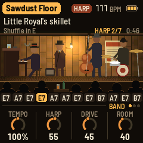

# JUKE JOINT

Endless blues trio for the M-VAVE FM-1. Plays by itself from power-on.

## What it plays

Piano, upright bass and brushes, playing a set in a back room. Every tune is new: slow 12/8 blues, medium
shuffle, minor blues or eight-bar slow ballad, each in its own key and tempo. Count-off or intro, the head, piano
choruses, now and then a stop-time chorus, the head out, an ending. Applause, a breath, the next tune.

A harmonica player sits in on some tunes. Answers the piano's calls in the head, takes a chorus, sits down again.
Bass walks or plays the two-beat. Room murmur and glasses on their own level.

Screen: band on a low stage under one bare bulb. Form along the bottom, current bar lit.

## Controls

| Control | Does |
| --- | --- |
| Knobs 1-4 | page's values. Band page: tempo, harp, drive, room |
| HOME, ENV, GLO | pages: Band, Mix (piano, bass, drums, ambience), Setup (age, width, tune length, lights) |
| SELECT | steps pages |
| ALGORITHM | harp: how often he sits in. 0: never |
| PRESETS | night. Each keeps its own settings |
| PLAY | play / rest |
| EDIT | next tune |
| REC | repeat: solos go round again |
| OCT- / OCT+ | keys' octave |
| Keys | play along on the piano |
| SAVE | saves. Held: night back to its recipe |

Hold any button for its help card. Settings save themselves at a quiet moment. USB audio follows MASTER.

## Nights

Sawdust Floor, Cigar Box Choir, Catfish Plate, Hambone Annie, Smokehouse, Tin Roof Ticks, Two Dollar Cot, Chitlin
Circuit, Deacon's Flask, Mule Shoes, Ida Belle, Busted Jukebox, Lamp Oil.

## Credits

Built on [AMB-1](https://github.com/charlesvestal/fm1-amb) by Charles Vestal (its platform use, knob strip, help
cards, screen reader), on [fm1-base](https://github.com/charlesvestal/fm1-base) and
[felucca-bsp](https://github.com/hugelton/felucca-bsp), from Felucca by Leo Kuroshita (Hügelton Instruments).
Piano voice from FELT PIANO. MPL-2.0: see `LICENSING.md`.
