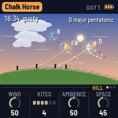

# KITE HILL

Windy hilltop full of kites, for the M-VAVE FM-1. Plays by itself from power-on.

## What it plays

Every kite line hums a note from the hill's tuning set and the chord of the moment. Kites climb in steady wind and
sink in lulls, so notes swell and fade. Gusts lift them all at once. New kites bring new notes. Now and then one
breaks loose and drifts off on a falling tone.

Day runs by itself: still morning, rising wind, steady afternoon, gusty evening, easing dusk. Harmony moves through
a short ring of chords sharing notes. Each new day moves to a near key. Low drone underneath; wind bed on its own
level.

Screen: sky by the time of day, drifting clouds, kites with tails, lines lit as they sing.

## Controls

| Control | Does |
| --- | --- |
| Knobs 1-4 | page's values. Hill page: wind, kites, ambience, space |
| HOME, ENV, GLO | pages: Hill, Line (tone, breath, drone, swell), Setup (width, day length, lights) |
| SELECT | steps pages |
| ALGORITHM | ambience |
| PRESETS | hill. Each keeps its own settings |
| PLAY | play / rest |
| EDIT | on to the next part of the day |
| REC | hold the weather: day stands still |
| OCT- / OCT+ | keys' octave |
| Keys | send up a kite on the nearest note that fits |
| SAVE | saves. Held: hill back to its recipe |

Hold any button for its help card. Settings save themselves at a lull, the day at most hourly. USB audio follows
MASTER.

## Hills

Chalk Horse, Patang, Seventh Partial, Rokkaku, Beaufort Six, Linen Delta, Barrow Top, Sixpence Spool, Paper Hawk,
Thermal Chimney, Ninety Feet Up, Uncle's Diamond. Each its own tuning (major and minor pentatonic, Lydian, the
harmonic series in just intonation, yo scale, Dorian, Mixolydian, minor, major, Phrygian, suspended pentatonic, major
sevenths), line sound and weather.

## Credits

Built on [AMB-1](https://github.com/charlesvestal/fm1-amb) by Charles Vestal (its platform use, knob strip, help
cards, screen reader), by way of FELT PIANO, on [fm1-base](https://github.com/charlesvestal/fm1-base) and
[felucca-bsp](https://github.com/hugelton/felucca-bsp), from Felucca by Leo Kuroshita (Hügelton Instruments).
MPL-2.0: see `LICENSING.md`.
