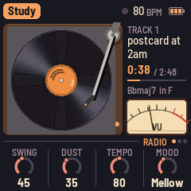

# LOFI RADIO

Endless lo-fi hip-hop radio for the M-VAVE FM-1. Plays by itself from power-on.

## What it plays

Generated tracks, one after another. Each has its own key, tempo (70-90 BPM), groove and title. Jazzy 7th and 9th
chords (ii-V-I and friends) on a dusty Rhodes, Wurli or felt piano. Swung boom-bap drums, a round bass, now and
then a muted lead or vibraphone melody. Vinyl crackle, tape wobble, a low-passed warmth over all of it. Every few
minutes the track fades, the needle runs out, and the next record starts.

Screen shows a turntable: spinning record with a new label colour each track, tonearm, VU meter, track name, time
and current chord.

## Controls

| Control | Does |
| --- | --- |
| Knobs 1-4 | page's values. Radio page: swing, dust, tempo, mood (jazzy to melancholy) |
| HOME, ENV, GLO | pages: Radio, Mix (keys, drums, bass, melody), Room (tone, rain, track length, lights) |
| SELECT | steps pages |
| ALGORITHM | tone |
| PRESETS | style. Each keeps its own settings |
| PLAY | needle up / down |
| EDIT | next track |
| REC | repeat: this track plays on |
| OCT- / OCT+ | keys' octave |
| Keys | play the electric piano along |
| SAVE | saves. Held: style back to its recipe |

Hold any button for its help card. Settings also save themselves at a quiet moment. USB audio follows MASTER.

## Styles

Study, Rainy Window, Jazz Cafe, Late Bus, Sunday, Vinyl Dust, Tokyo Night, Snow Day, Library, Midnight Tea, Old
Tape, Sleepy Cat, Golden Hour, Rooftop.

## Credits

Built on [AMB-1](https://github.com/charlesvestal/fm1-amb) by Charles Vestal (its platform use, knob strip, help
cards, screen reader), on [fm1-base](https://github.com/charlesvestal/fm1-base) and
[felucca-bsp](https://github.com/hugelton/felucca-bsp), from Felucca by Leo Kuroshita (Hügelton Instruments).
MPL-2.0: see `LICENSING.md`.
