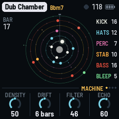

# MINIMAL MACHINE

Endless minimal techno for the M-VAVE FM-1. Plays by itself from power-on.

Six short loops, each its own length: deep kick, soft hats, rim or clap, dub chord stab into a ping-pong echo, sub
bass, small bleep. Lengths differ (16, 12, 7, 10...), so the parts phase against each other slowly. Every few bars
one thing mutates: a hit moves a step, a note changes, a loop grows by a step, a part rests. Never a jump.

Screen shows the loops as rings turning against each other. The step playing sits under the read head at the top.
Mutations flash white.

## Controls

- **Knobs (Machine page, HOME):** Density, Drift (how often it mutates; 0 holds), Filter, Echo.
- **ENV:** Mix (Drums, Stab, Bass, Bleep). **FX:** Space (Swing, Echo time, Reverb, Duck). **GLO:** Setup (Tempo,
  Key, USB level, Lights).
- **PRESETS** or **OCT- / OCT+:** preset. **ALGORITHM:** key. **HOME + SELECT:** tempo.
- **White keys 1-6:** mute Kick, Hats, Perc, Stab, Bass, Bleep.
- **PLAY:** stop / start. **REC:** Hold (no mutations). **EDIT:** mutate now.
- **SAVE:** save now. Hold 1.5 s: preset back to its recipe. Hold any button for its help card.

USB audio follows the MASTER knob by default (Setup: USB level Master). Full sends it at full level.

Saves itself rarely: settings at most every 5 minutes, evolved loops at most hourly, in a short gap before a
downbeat.

## Presets

Dub Chamber, Warehouse, Glass, Rubber, Fog Lights, Night Bus, Tape Delay, Concrete, Shallow Water, Signal Box, Low
Orbit, Afterhours.

## Install

Package on [releases](https://github.com/ashtonwallen/fm1-firmware/releases). Build notes in `BUILDING.md`.

## Credits

Built on [AMB-1](https://github.com/charlesvestal/fm1-amb) by Charles Vestal (app skeleton, UI helpers, screen
reader, saving) and [fm1-base](https://github.com/charlesvestal/fm1-base) / felucca-bsp, from Felucca by Leo
Kuroshita (Hügelton Instruments). Inspired by DUB-1 (Charles Vestal); no DUB-1 code. MPL-2.0: see `LICENSING.md`.
