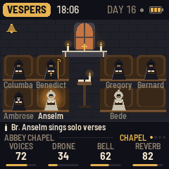
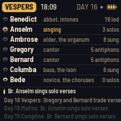

# MONASTERY for the M-VAVE FM-1

Monks sing the hours in a stone chapel. Self-playing firmware for the M-VAVE FM-1, built on AMB-1 by Charles Vestal.

 

Seven brothers chant slow modal lines over a drone, side answering side, through a long reverb. A bell marks each
office: Matins, Lauds, Prime, Terce, Sext, None, Vespers, Compline. Each has its own mode, pace and number of
singers. A whole day takes two hours by default.

The brothers have their ways:

- **Benedict**, the abbot. Intones, leads, frowns or nods at the novice.
- **Anselm**, the novice. Comes in early, misses entries, practises between offices. Learns. Takes his vows in time.
- **Ambrose**, the old brother. Sinks flat until the abbot gives him the note. Falls ill, comes back.
- **Gregory** and **Bernard**. Argue over the pitch: a brief clash, then one gives way. Make peace, for a while.
- **Columba**. Dozes off at Matins. Wakes with a start.
- **Bede**. A new novice who turns up at the gate after some days.

## Presets

Twelve presets, each a different place or rite: space, drone, bell, voices, finals, and AMB-1 Drift 1.1's harp,
kalimba, bowed or glass lead, air and shimmer. Turn **PRESETS**. The brothers, the day and the chronicle go on as
they were; knobs keep their values and act under the preset.

- **Abbey Chapel**: 1.0's sound.
- **Cathedral**: lower, slower, vast plate, shimmer, low bowed lead, deep bell.
- **Hermitage**: small dry cell, quicker chant, a harp, a little wind.
- **Cloister**: half-open walk, rain, a harp now and then.
- **Mountain Abbey**: lower, strong drone, wind, high glass lead, some shimmer.
- **Byzantine**: Phrygian, loud ison, wide vibrato, slow.
- **Candlelight**: close and warm, soft bell, glass lead, crackle of candles.
- **Island Abbey**: higher, sea outside, long echo, a harp.
- **Crypt**: a fourth down, darker, deeper voices, low bowed lead.
- **Snow Priory**: higher, bright, kalimba, glass lead, wind, shimmer.
- **Pilgrims**: harp rolls, bowed lead, wind.
- **Easter Vigil**: Lydian, bright, ringing bell, glass lead, shimmer.

Who sings glows by candlelight. The line under the chapel says what just happened. Brothers, their histories and
the chronicle survive power-offs. So does the preset; a 1.0 world loads whole on Abbey Chapel.

## Controls

| | |
|---|---|
| PLAY | Sing / rest. The world's clock stops while resting |
| EDIT | Ring the bell: the next office, now |
| REC | Hold: the note holds, the chapel rings on |
| OCT− / OCT+ | Slower / faster chant |
| White keys 1–7 | A brother. Asleep: he wakes. Otherwise he stands to sing the next verse |
| PRESETS | Next or previous preset. Name shows at the top, and left of the knobs |
| HOME · ARP · FX · GLO | Pages: Chapel, Brothers, Space, Setup. SELECT steps through them |
| KNOB 1–4 | Chapel: Voices, Drone, Bell, Reverb. Space: Echo, Size, Colour, Pace. Setup: Day length, Tune, MIDI out, Lights |
| SAVE | Save. Held: the sound back to defaults (the world stays) |

Saves by itself, rarely, while nobody sings: the world about once an hour (a power-off can lose up to an hour),
settings within 5 minutes. No USB level setting: USB audio is taken as AMB-1 takes it.

## Build

See `CLAUDE.md` and `BUILDING.md`. `./build.sh`, `./build.sh --host`, `sh tests/run_tests.sh`.

## Credits

Engine, UI and platform glue from [AMB-1](https://github.com/charlesvestal/fm1-amb) by Charles Vestal; strings, lead, air and shimmer from AMB-1 Drift 1.1. Platform:
[fm1-base](https://github.com/charlesvestal/fm1-base) and [felucca-bsp](https://github.com/hugelton/felucca-bsp), from
Felucca by Leo Kuroshita (Hügelton Instruments). All MPL-2.0; see `LICENSING.md`. The choir, the world and the
chapel: ashtonwallen.
