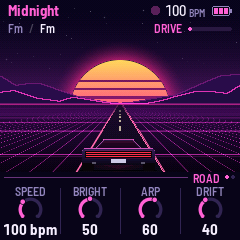
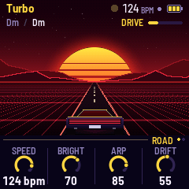
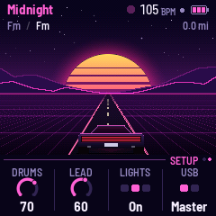

# NIGHT DRIVE

Endless synthwave for the M-VAVE FM-1. Switch it on and it drives.

Rolling 16th bass, arpeggios, detuned pads, punchy kick, big gated snare. Saw, square or FM-brass lead now and then.
Minor progressions (i VI III VII and friends). Sections come round by themselves: intro, drive, breakdown, build,
drive. Key changes now and then. All generated in code, no samples. Limiter on the master, so it never clips.

Screen: neon grid road toward striped sun, mountains on horizon, grid pulsing on kick, car tail lights flaring on
snare. Each preset has its own colours.

  

## Controls

| | |
|---|---|
| KNOB 1-4 (Road) | Speed (85-130 bpm), Bright (filter), Arp (density, 0 = off), Drift (how often sections and keys change) |
| KNOB 1-4 (Setup, GLO) | Drums, Lead, Lights, USB level |
| PRESETS | Next or previous preset |
| ALGORITHM | Chord progression |
| Keys · OCT-/OCT+ | Key (lands on next bar) |
| PLAY · EDIT · REC · ARP | Drive or park · next section · key change · next arp pattern |
| SAVE | Saves; held, puts preset back to its recipe |

Hold any button for a second for a help card. USB level follows MASTER knob by default; Setup can set it to full.
Settings save themselves a while after you stop turning knobs.

## Presets

Midnight, Sunset Strip, Chrome, Turbo, Neon Rain, Coastline, Arcade, Outrun, Afterglow, Palm Haze, Overdrive,
Starfield, Interstate, Laserdisc. Each has its own key, speed, sounds and palette.

## Install

Firmware file on [releases](https://github.com/ashtonwallen/fm1-firmware/releases). Installing is at your own risk.

## Credits

Built on AMB-1 by Charles Vestal, and [fm1-base](https://github.com/charlesvestal/fm1-base) /
[felucca-bsp](https://github.com/hugelton/felucca-bsp), from Felucca by Leo Kuroshita (Hügelton Instruments).
Plate reverb after Jon Dattorro. MPL-2.0; see [LICENSING.md](LICENSING.md). M-VAVE and FM-1 are trademarks of
their owners; not affiliated.
