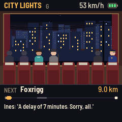

# NIGHT TRAIN

Endless night train for the M-VAVE FM-1. Self-playing ambient music, a window on a journey that never ends, and the people who ride it.

## What it is

Train runs a seeded route, station to station. Each stretch has its own landscape: forest, coast, city lights, snowfields, mountains, villages, lakes, moors. Tunnels, bridges, signal stops in the dark, rain on the glass.

Each landscape has its own key and sound. The wheels' clack is the beat. It follows the train: slows into a station, quickens away from it. At a station the music thins, a chime rings, doors open, passengers get off and on. The key moves to the next stretch while the train stands.

Six regulars ride it. Ines, conductor, in her last winter on the line. Mara, night nurse, falls asleep and misses her stop. Theo, cellist, has an audition. Aldous, old man, won't say where he's going. June, art student, draws everyone. Biscuit, a cat nobody owns. They talk, nap, argue, fall in with each other. Their stories move on over many nights.

Everything is saved: distance, stations, who sits where, every story so far. It saves itself about once an hour, so a power-off can lose up to an hour of the journey. SAVE keeps it now.

## Controls

- **Power on**: it plays. Train stands at its first station, then pulls away.
- **HOME**: window. **K1** stretch (3 to 20 minutes between stations), **K2** clack (wheels' volume), **K3** tone, **K4** space.
- **SEQ**: journal, newest first. **K1** or **ALGORITHM** scrolls.
- **ENV**: passengers. Who is aboard, asleep or off, mood, latest story line.
- **GLO**: setup. **K1** tune, **K2** MIDI out, **K3** lights. Journey so far.
- **SELECT**: steps through pages.
- **PRESETS** (turn right): express to next station.
- **PLAY**: train runs or stands. Journey waits while it stands.
- **REC**: freeze. Chord holds, reverb rings on.
- **EDIT**: next chord.
- **Keys**, MIDI notes in: soft bell in the stretch's key.
- **SAVE**: save now. Also saves itself at a station or standing, about once an hour (settings: within 5 minutes).
- Hold any button for its card.

USB audio: recordable over USB as AMB-1 does it. No USB level setting; MASTER sets the level.

## Build

Needs fm1-base's toolchain (see `BUILDING.md`). `./build.sh`, `./build.sh --host`, `sh tests/run_tests.sh`, `./build.sh --release 1.0`.

## Credits

Engine: [AMB-1](https://github.com/charlesvestal/fm1-amb) by Charles Vestal (MPL-2.0): breathing pad, FM bells on tape loops, gliding bass, Euclidean pulse, tape echo, Dattorro plate. Platform: [fm1-base](https://github.com/charlesvestal/fm1-base) and [felucca-bsp](https://github.com/hugelton/felucca-bsp), from Felucca by Leo Kuroshita (Hügelton Instruments). World, train sounds, screen: ashtonwallen. MPL-2.0; see `LICENSING.md`.
