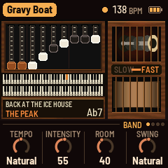

# ORGAN TRIO

Endless soul-jazz organ trio for the M-VAVE FM-1. Plays by itself from power-on.

## What it plays

Tonewheel organ, jazz guitar and drums working through a set. Organist's left hand plays bass. Every tune is new:
greasy blues, slow minor blues in 12/8, soul-jazz grooves, gospel ballads, shuffles, swing.

Head, organ and guitar solos, sometimes fours, head out, ending. Organ builds to a shout: speaker to fast, drawbars
pulled out. Applause, next tune.

Organ built from drawbars, percussion, key click, chorus, drive and a rotating horn and drum. Screen shows drawbars
moving, keys going down, speaker turning.

## Controls

| Control | Does |
| --- | --- |
| Knobs 1-4 | page's values. Band page: tempo feel, intensity, room, swing |
| HOME, ENV, LFO, GLO | pages: Band, Mix (organ, guitar, drums, crowd), Organ (drawbars, speaker, drive, percussion), Set (tone, solo focus, solo length, lights) |
| SELECT | steps pages |
| ALGORITHM | tone |
| PRESETS | band. Each keeps its own settings |
| PLAY | band plays / takes a break |
| EDIT | next tune |
| REC | keep blowing: solos go on |
| OCT- / OCT+ | keys' octave |
| Keys | play organ along |
| SAVE | saves. Held: band back to its recipe |

Hold any button for its help card. Settings also save themselves at a quiet moment. USB audio follows MASTER.

## Bands

Gravy Boat, Sixteen Feet, Hot Comb, Fish Fry, Amen Corner, Third Harmonic, Choir Robe, Percolator, Velvet Booth,
Collard Greens, Two-Tone Shoes, Holy Roller, Hush Puppies.

## Credits

Built on [AMB-1](https://github.com/charlesvestal/fm1-amb) by Charles Vestal, on [fm1-base](https://github.com/charlesvestal/fm1-base) and
[felucca-bsp](https://github.com/hugelton/felucca-bsp), from Felucca by Leo Kuroshita (Hügelton Instruments).
MPL-2.0: see `LICENSING.md`.
