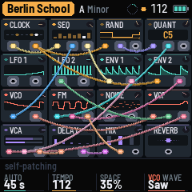

# Patch Bay

Self-patching virtual modular synth for the M-VAVE FM-1. Plays from power-on.

Sixteen modules on screen, each a panel with jacks, a light and a live display: clock, sequencer, random, quantizer,
two LFOs, two envelopes, VCO, FM pair, noise, filter, VCA, delay, mixer, reverb. Coloured cables sag between them.
Every so often one cable lifts, flies to another jack and plugs in. New patch, new music. Every move is checked
first: pitch in key, something sounding, no audio loops. Levels stay even, top end soft.

## Controls

| Control | Does |
| --- | --- |
| SELECT / ALGO | Pick module, then jack |
| EDIT or SEL | Plug, unplug, carry a cable |
| HOME | Cursor away, drop held cable |
| KNOB 1-3 | Auto-patch rate (off, 6 s to 5 min), tempo, space |
| KNOB 4 | Selected module's knob |
| PRESETS / REC | Next patch / one move now |
| Keys, OCT- OCT+ | Key, scale |
| PLAY / SAVE | Pause / save (hold: reset preset) |

Touching the patch pauses the auto-patcher for 90 s. Hold a button for its help card. Screen reader supported.
MASTER sets speaker and USB level alike.

## Presets

Berlin School, Bleeps, West Coast, Drone Cathedral, Random Garden, Krell, Plinky, Tape Choir, Night Rain, Sine
Tides, Clockwork, Polymeter.

## Credits

Built on [AMB-1](https://github.com/charlesvestal/fm1-amb) by Charles Vestal, on
[fm1-base](https://github.com/charlesvestal/fm1-base) and [felucca-bsp](https://github.com/hugelton/felucca-bsp),
from Felucca by Leo Kuroshita (Hügelton Instruments). MPL-2.0, see `LICENSING.md`. Install at your own risk.
