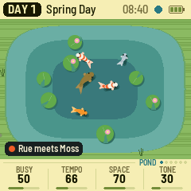

# POND

Custom firmware for the M-VAVE FM-1. Fish in a pond, singing.

Each fish has a name, species, temperament and note. Species sets its voice: koi round, goldfish soft, minnow bright,
carp low. Fish sing softly as they swim. Two fish meet, their notes ring together as a chord, ripples spread and the
pad moves to a chord that holds both. Shy fish hide by the lily pads. Greedy ones race for food. Social ones find
friends. Grumpy ones chase others off. Friends and rivals form over days.

Well-fed friends have fry in spring and summer. Old fish drift off. A quiet pond gets a newcomer at dawn. Seasons turn
every four days (Lydian, Ionian, Dorian, Aeolian). Nights are dark and slow, with frogs. Now and then a heron lands:
sudden silence, the fish scatter, then their notes come back. The pond saves itself about once an hour
(SAVE keeps it now), so a power-off can lose up to an hour of it.

Starts singing at power-on. Left alone it settles into quiet ripples, slow drones and the odd plip.

## Presets

LFO steps through thirteen sound palettes, SEL steps back: Mill Pond (as 1.0), Koi Garden, Lily Night, Mountain Tarn,
Rain Pond, Frozen Edge, Lotus Temple, Willow Bank, Dragonfly Noon, Bog Mist, Moon Pool, Spring Thaw, Old Well. Name
shows on screen. Each recolours the pond: key, mode, tempo, pad, space, and AMB-1 Drift 1.1's strings, lead, air and
shimmer. Fish, friendships, day and journal stay as they are. Kept with the settings. Details: `docs/presets.md`.

## Controls

- **Keys**: drop food where the key sits along the pond. Its note joins the scale for 90 s.
- **PLAY**: music on or resting. The pond lives on.
- **ARP**: a pinch of food everywhere. **EDIT**: next chord, chosen by the fish. **REC**: freeze.
- **OCT- / OCT+**: fish sing lower or higher.
- **PRESETS**: follow a fish. Its name shows in the corner.
- **LFO / SEL**: next / last preset.
- **HOME** pond, **ENV** fish card, **SEQ** journal, **FX** mix, **GLO** setup (again: world).
- **ALGORITHM**: Busy. **KNOBS 1-4**: the page's values.
- **SAVE**: save now. Hold 3 s: new pond (the old one is gone).

Hold any button for its help card. Day length is on the World page (6 to 96 minutes, 24 by default).

## Build

See `BUILDING.md`. WSL Ubuntu with the JieLi toolchain: `./build.sh`, `./build.sh --host`, `sh tests/run_tests.sh`.

## Credits

Built on [AMB-1](https://github.com/charlesvestal/fm1-amb) by Charles Vestal: its engine (pad, FM bells, gliding bass,
pulse, tape echo, Dattorro plate), UI helpers and screen reader. Strings, lead, air and shimmer from AMB-1 Drift 1.1. On [fm1-base](https://github.com/charlesvestal/fm1-base)
and [felucca-bsp](https://github.com/hugelton/felucca-bsp), from Felucca by Leo Kuroshita (Hügelton Instruments).
MPL-2.0. See `LICENSING.md`.
