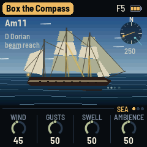

# RIGGING

Tall ship crossing open ocean, played by the wind. Firmware for the M-VAVE FM-1. Plays by itself from power-on.

## What it plays

Every rope and stay is a tuned string. Wind finds it, it hums. Shrouds low, stays in the middle, topmast stays high.
Steady wind holds a few low ropes; gusts roll along the rig on the swell's crest and light the high ones in turn.

Wind angle picks the chord. Close-hauled, close reach, beam, broad, running: each point of sail has its chord in the
preset's chain, neighbours sharing tones. Ship changes course now and then, so harmony moves one step at a time.
Ropes retune only once quiet. Nothing clashes.

Squalls make all twelve ropes sing, harmonics whistling. Calms leave the creak. Hull hums the root. Ship's bell
strikes the watch every half hour. Every hour or so, a near key. Weather and voyage carry on for hours and are kept
across power-off.

Ambience knob: wind, sea wash, sails filling and flapping, hull creaks. Separate from the music.

Screen: ship from the side. Sails fill or flap, ropes glow as they sound, swell rolls, wind streaks, compass with
heading and wind. St. Elmo's fire in a squall.

## Controls

| Control | Does |
| --- | --- |
| Knobs 1-4 | page's values. Sea page: wind, gusts, swell, ambience |
| HOME, ENV, GLO | pages: Sea, Rig (breath, tone, hull, bell), Setup (room, width, helm, lights) |
| SELECT | steps pages |
| ALGORITHM | ambience |
| PRESETS | preset. Each keeps its own settings |
| PLAY | play / rest |
| EDIT | come about: new course now |
| REC | hold the helm: no course changes |
| OCT- / OCT+ | five degrees to port / starboard |
| Keys | trim the course, a degree a key from the middle |
| SAVE | saves. Held: preset back to its recipe |

Hold any button for its help card. Settings save themselves at a quiet moment, the voyage at most hourly. USB
audio follows MASTER.

## Presets

Box the Compass, Cat's Paw, Roaring Forties, Doldrum Choir, St. Elmo's Fire, Ratline Hymn, Plimsoll Mark, Growler
Watch, Spindrift, Sargasso Slack, Tea Clipper, Hove To. Each its own sea, weather, tuning and sky: Dorian chains,
pentatonics, Lydian, Phrygian, ropes in fifths, a just-tuned calm.

## Credits

Built on [AMB-1](https://github.com/charlesvestal/fm1-amb) by Charles Vestal (its platform use, knob strip, help
cards, screen reader), on [fm1-base](https://github.com/charlesvestal/fm1-base) and
[felucca-bsp](https://github.com/hugelton/felucca-bsp), from Felucca by Leo Kuroshita (Hügelton Instruments).
MPL-2.0: see `LICENSING.md`.
