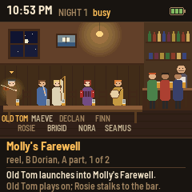

# TAVERN

Folk session in a tavern corner, on the M-VAVE FM-1. Plays all night by itself.

  

Eight regulars drift in through the evening. Fiddles, a whistle, a harp, a lute, a box, a double bass, a bodhran. One starts a tune; the others join on the repeat. Tunes are generated in Dorian, Mixolydian, Aeolian and Ionian, AABB form: reels and jigs in the busy middle of the night, waltzes and slow airs late.

They have moods, thirst, friends and rivals. Old Tom and Rosie won't play together. Nora can't abide the drum. Strangers get a seat or get frozen out. Late on, someone plays a lament. Some nights turn into singers' nights. Strings break. Hugh calls last orders, then "Time", then plays his own air to an empty room. A new night starts at dawn.

Regulars, their quarrels and memorable nights survive power-off.

## Presets

Twelve session styles: which tunes, modes, tempo, singing, who plays out, the room, and AMB-1 Drift 1.1's air and shimmer. Turn **PRESETS**. Regulars, the night and its log go on; the band rebalances now, the style shows from the next tune.

- **The Corner**: 1.0's session.
- **Highland Pub**: reels, Mixolydian, whistle and drum up, rain outside.
- **Breton Fest-noz**: dance tunes, Aeolian, lots of singing, the box up.
- **Nordic Hall**: waltzes and airs, harp, wide room, wind, shimmer.
- **Sea Shanty Inn**: songs, Ionian, the voice and box up, sea outside.
- **Quiet Corner**: slow airs and waltzes, harp, soft drum, fire crackle.
- **Harvest Night**: quick reels and jigs, bright, fire.
- **Rainy Night**: airs and waltzes, Aeolian, rain on the window.
- **Midwinter**: slow, Aeolian, waltzes and airs, harp, wind, shimmer.
- **Wedding Party**: fastest, jigs and reels, Ionian, bright.
- **Stone Hall**: echoing stone room, harp, shimmer.
- **Lock-in**: after hours, slow, dark, singing, the fire.

## Controls

| | |
|---|---|
| Power on | Doors open, first two regulars come in, a tune starts in a few seconds |
| PLAY | Pause. The night waits too |
| REC | Round for the house. Once an hour |
| EDIT | Call for a tune. Between tunes: now. During one: another right after |
| Keys | Ask for the next tune's key |
| HOME · ENV · ARP · FX · LFO · GLO | Tavern, Regulars, Nights, Mix, Room, Setup |
| KNOB 1-4 | Page's values. On a page without knobs: Melody, Backing, Bodhran, Echo |
| PRESETS | Next or previous style. Name shows at the top and left of the knobs |
| SELECT | Previous or next page |
| SAVE | Saves. It also saves by itself between tunes, about once an hour (a power-off can lose up to an hour) |

Hold a button for a second: a card says what it does. Room page has Night: 20 minutes to 2 hours per night (default 1 hour).

USB audio comes over the cable as in AMB-1: the master knob sets the level, no separate USB setting.

## Build

App on [fm1-base](https://github.com/charlesvestal/fm1-base) (`base/`, a submodule). Toolchain in [BUILDING.md](BUILDING.md).

```
sh tests/run_tests.sh          # band, scenarios in the simulator
./build.sh --release 1.1       # app/build/tavern-1.1.fwsc
```

Installing firmware is at your own risk.

## Credits

Fork of AMB-1 by Charles Vestal: its structure, UI, store, plate reverb and tape echo. Air and shimmer from AMB-1 Drift 1.1. Built on [fm1-base](https://github.com/charlesvestal/fm1-base) and [felucca-bsp](https://github.com/hugelton/felucca-bsp), from [Felucca](https://github.com/hugelton/Felucca) by Leo Kuroshita (Hügelton Instruments). MPL-2.0; see [LICENSING.md](LICENSING.md).

M-VAVE and FM-1 are trademarks of their owners. Not affiliated with M-VAVE, Hügelton Instruments or AMB-1's author.
