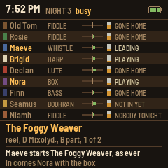
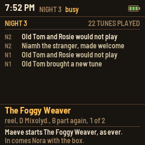

# TAVERN

Folk session in a tavern corner, on the M-VAVE FM-1. Plays all night by itself.

  

Eight regulars drift in through the evening: fiddles, whistle, harp, lute, box, double bass, bodhran. One starts a tune; the others join on the phrase. Tunes are generated in folk modes, AABB form. Busy middle of the night brings reels and jigs, often in sets that run straight on into a new key. Players trade parts, a visitor sits in, someone plays a lament late. Hugh calls time and plays his own air to an empty room. New night at dawn.

Nobody plays badly. Regulars and memorable nights survive power-off.

## Presets

Twelve session styles, turned with **PRESETS**: tunes, modes, tempo, singing, the band's balance, the room, and AMB-1 Drift 1.1's air (rain, wind, sea, fire) and shimmer.

## Controls

| | |
|---|---|
| PLAY | Pause |
| REC | Round for the house. Everyone in. Once an hour |
| EDIT | Call for a tune |
| Keys | Next tune's key |
| HOME · ENV · ARP · FX · LFO · GLO | Tavern, Regulars, Nights, Mix, Room, Setup |
| Room page | Reverb, Room, Tone, Ambience: rain, wind, sea or fire, off to 125 %, kept per preset |
| Setup page | Tune, MIDI out, Lights, Night length (20 min to 2 h) |
| SAVE | Saves now. Also saves itself between tunes |

Hold a button: a card says what it does.

## Build

App on [fm1-base](https://github.com/charlesvestal/fm1-base) (`base/`). Toolchain in [BUILDING.md](BUILDING.md).

```
sh tests/run_tests.sh          # band, scenarios in the simulator
./build.sh --release 1.2       # app/build/tavern-1.2.fwsc
```

Installing firmware is at your own risk.

## Credits

Fork of AMB-1 by Charles Vestal. Air and shimmer from AMB-1 Drift 1.1. Built on [fm1-base](https://github.com/charlesvestal/fm1-base) and [felucca-bsp](https://github.com/hugelton/felucca-bsp), from [Felucca](https://github.com/hugelton/Felucca) by Leo Kuroshita (Hügelton Instruments). MPL-2.0; see [LICENSING.md](LICENSING.md).

M-VAVE and FM-1 are trademarks of their owners. Not affiliated with M-VAVE, Hügelton Instruments or AMB-1's author.
