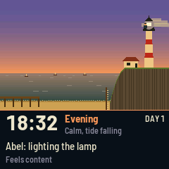

# Tide Clock

Firmware for the M-VAVE FM-1. Ambient music that follows the time of day, and a small coast on the screen that keeps
time with it.

## What it does

Plays by itself from power-on. Before dawn: low, sparse, near-silent drones. Morning: brighter, busier. Midday: full.
Evening: warm and golden. Night: dark, slow. Key, mode, tempo, density, brightness, layers and space all move with
the hours, gradually. A sea layer washes under it all.

On the screen: sky colour for the hour, sun and moon on their arcs, two tides a day, three fishing boats out at dawn
and home at dusk, gulls, weather. Fog, wind, and now and then a storm that takes over the music for a while.

Abel keeps the lighthouse. Lights the lamp at dusk, sleeps, feeds Captain the gull, combs the beach at low tide,
worries when a boat is late in a storm. Keeps a log of days survived and what happened. All of it is saved, about
once an hour (SAVE keeps it now).

## Presets

PRESETS turns through thirteen sound palettes: Harbour (as 1.0), Fjord, Tropical Atoll, Winter Coast, Misty Isles,
Lighthouse Choir, Sea Glass, Gale Warning, Night Ferry, Saltmarsh, Long Light, Chapel Bay, Kelp Forest. Name shows on
screen. Each recolours the day: key, mode, tempo, pad, space, and AMB-1 Drift 1.1's strings, lead, air and shimmer.
Time, weather, boats, Abel and his log carry on untouched. Kept with the settings. Details: `docs/presets.md`.

## Two modes

- **Clock**: real time. FM-1 has no clock, so it asks at power-on, starting from the last time it saved. Any knob
  moves 15 minutes. PLAY confirms, or leave it 20 seconds.
- **Cycle**: a whole day every 1, 2, 4, 8 or 12 hours. Nothing to set.

## Controls

| Control | Does |
| --- | --- |
| PLAY | music rests / plays (world goes on) |
| EDIT | set the clock |
| HOME | coast |
| SEQ | Abel's log (knob 1 scrolls) |
| GLO | setup: mode, cycle, sea level, lights |
| SELECT | pages in turn |
| PRESETS | sound palette (Harbour, Fjord ...) |
| SAVE | save now (it also saves by itself) |

Hold a button for a moment to see what it does. USB audio works as in AMB-1: no level setting, MASTER sets it.

## Build

WSL with the JieLi toolchain: `./build.sh`, `./build.sh --host`, `sh tests/run_tests.sh`, `./build.sh --release 1.1`.

## Credits

Built on [AMB-1](https://github.com/charlesvestal/fm1-amb) by Charles Vestal: its generative engine (pad, bells on
tape loops, bass, Euclidean pulse, echo, tape, plate reverb) plays the day; its 1.1 sounds (strings, lead, air, shimmer) come from AMB-1 Drift. Platform:
[fm1-base](https://github.com/charlesvestal/fm1-base) and [felucca-bsp](https://github.com/hugelton/felucca-bsp), from
Felucca by Leo Kuroshita (Hügelton Instruments). MPL-2.0; see `LICENSING.md`. Not affiliated with M-VAVE.
